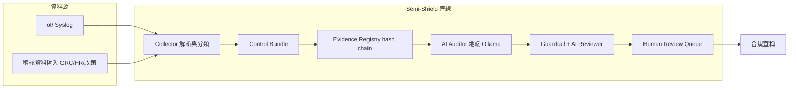

# 半導體 OT 場域之 AI 驅動證據鏈與傳統稽核路徑比較研究  
## ——以 Semi-Shield ISMS 實作為例

**摘要：** 半導體封裝與製造場域的營運技術（Operational Technology, OT）環境，在 ISO/IEC 27001:2022 稽核中常面臨「證據分散、難以重播、合規結論與原始紀錄脫鉤」等問題。本文以開源實作平台 **Semi-Shield ISMS** 為案例，提出以 **AI 證據鏈（AI-driven evidence chain）** 為核心的合規方法，並與 **傳統稽核證據鏈** 做系統性對照。Semi-Shield 將 OT syslog、控制項 KPI 與非遙測類稽核資料（政策、GRC、HR、實體紀錄）匯入同一管線，經 **Control Bundle → Evidence Registry（SHA-256 hash chain）→ 地端 LLM 診斷 → 護欄與 AI Reviewer → Human Review Queue** 後，方允許合規宣稱，並以 **「No Evidence, No Compliance Claim」** 為不可違反之設計原則。實作上支援 Annex A **93 項**控制項視圖（含 OT 自動分類與 AI 全自動匯入兩類自動化分級），並於監控戰情室提供 Semi-Shield 與傳統路徑的並列流程比較。研究結果顯示：AI 證據鏈在 **可追溯性、完整性校驗、控制項對映規模與 OT 即時性** 上優於傳統以 Excel／Email／PDF 為主的作法；傳統路徑在 **人工彈性與離線稽核習慣** 上仍具適用情境，但需承擔較高的營運與稽核成本。

**關鍵詞：** ISO 27001；OT 資安；證據鏈；合規自動化；大型語言模型；Syslog；hash chain

---

## 1 緒論

### 1.1 研究背景

半導體供應鏈的 ISMS 稽核，除 IT 一般控制外，OT 區域（Purdue 模型 Level 0–3.5）需證明存取控制、組態變更、日誌完整性、惡意程式防護等要求。實務上，證據常來自交換器 flash 匯出之 syslog、SCADA／MES 紀錄，以及政策文件與人員訓練紀錄。傳統作法依賴工程師 **CLI 匯出、截圖、試算表彙整與 Email 傳遞**，稽核員再以 **訪談與靜態 PDF** 形成結論。此模式在 **跨控制項關聯、事件重算、完整性證明** 方面存在結構性弱點。

近年地端部署之大型語言模型（LLM）與 RAG（Retrieval-Augmented Generation）技術，使「在場域內對原始紀錄做診斷摘要」成為可能；若缺乏 **證據 ID、雜湊鏈與審核閘門**，則 LLM 輸出易淪為不可稽核的自由文字。Semi-Shield ISMS 之設計目標，即為 **將 AI 嵌入可驗證之證據鏈**，而非取代證據本身。

### 1.2 研究問題

1. 傳統 OT 合規證據鏈在 ISO 27001 Annex A 對映上有哪些結構性限制？  
2. AI 證據鏈應包含哪些必要節點，才能同時滿足 **自動化效率** 與 **稽核可追溯**？  
3. 在相同控制項集合下，Semi-Shield 路徑與傳統路徑於 **資料來源、完整性、AI 診斷綁定、人工閘門、即時性** 等面向有何差異？

### 1.3 貢獻

- 提出 **雙軌自動化分級**：`auto_syslog`（OT 遙測／syslog 分類桶）與 `auto_import`（AI 全自動匯入稽核資料）。  
- 實作 **Evidence Registry** 與 **hash chain**，並將 LLM 診斷約束於 bundle 原文引用。  
- 於監控戰情室提供 **93 控制項** 之證據鏈流程視覺化，並內建 **Semi-Shield vs 傳統** 對照表。

---

## 2 傳統稽核證據鏈及其限制

### 2.1 典型流程（Traditional Evidence Chain）

本專案將傳統路徑抽象為五個步驟（見 `evidence_chain_service._traditional_steps`）：

| 步驟 | 活動 | 特徵 |
|------|------|------|
| T1 | 人工 CLI／截圖 | 無集中 collector，設備與人員異質 |
| T2 | Excel／Word 清單 | 版本分散，欄位不一致 |
| T3 | Email 傳遞 | 附件散落，缺乏密碼學完整性 |
| T4 | 靜態 PDF 報告 | 稽核當下快照，難以對同一 KPI 重算 |
| T5 | 訪談式合規宣稱 | 缺乏行級 trace，通常無 `evidence_id` |

### 2.2 結構性問題

1. **弱關聯（weak linkage）**：合規結論與原始 syslog 行號、檔名、時間戳之間常無機器可讀連結。  
2. **不可重播（non-replayable）**：PDF 為靜態快照，OT 環境變更後無法以相同規則重算指標。  
3. **跨控制項拼貼成本高**：例如 A.5.15（存取控制）與 A.8.19（安裝軟體於營運系統）需人工關聯多份匯出。  
4. **AI 使用失序**：若直接在 Chat 介面詢問「是否合規」，輸出無 evidence 綁定，不符合「可證明宣稱」之稽核邏輯。

---

## 3 Semi-Shield AI 證據鏈架構

### 3.1 設計原則

**No Evidence, No Compliance Claim：** 任何合規宣稱必須對應 Evidence Registry 中之 `evidence_id`，且 payload 經 SHA-256 雜湊並鏈結至前一筆紀錄（`prev_hash` → `payload_hash`）。

### 3.2 邏輯架構



### 3.3 雙軌自動化分級

| 分級 | 代碼 | 資料來源 | Semi-Shield 鏈前段差異 |
|------|------|----------|-------------------------|
| OT Syslog 自動化 | `auto_syslog` | `ot/` 目錄、Cisco 等設備 syslog | 正規化 → Regex／信號分類 → KPI 計數 |
| AI 全自動匯入 | `auto_import` | 政策、訓練紀錄、門禁、實體稽核表等 | AI 文件解析 → Annex A 對映 → 完整性檢查 |

兩軌在 **Control Bundle 之後合流**：皆經 Evidence Registry、LLM 診斷、護欄、Review Queue 後方可宣稱。

### 3.4 AI 證據鏈節點說明（Syslog 軌）

1. **OT 設備 Syslog**：集中存放於 `ot/`，保留檔名與設備 IP 對應。  
2. **Collector 解析**：Cisco syslog 正規化，對映 Annex A 控制項。  
3. **控制項分類桶**：以規則／信號累計 KPI（如存取拒絕、組態變更計數）。  
4. **Control Bundle**：事件樣本 + `metric_summary`，供 LLM 與報告引用。  
5. **Evidence Registry**：產生 `EV-{site}-{control_key}-{utc}-{hash8}`，append-only JSONL，含 hash chain。  
6. **AI Auditor (LLM)**：地端 Ollama（可微調 OT 領域模型），診斷須引用 bundle 原文。  
7. **Guardrail + AI Reviewer**：輸入／輸出護欄，降低幻覺與越權建議。  
8. **Human Review Queue**：`review`／`fail` 狀態強制人工核准。  
9. **合規宣稱**：僅在 evidence 鏈完整時納入稽核報告。

### 3.5 AI 證據鏈節點說明（匯入軌）

前段改為 **稽核資料匯入 → AI 文件解析（OCR＋結構化）→ 完整性檢查**，其後與 Syslog 軌相同。此設計將 **A.6／A.7 等人員與實體面控制項** 納入同一證據語意，避免「OT 自動、其餘人工」造成戰情室視野断裂。

---

## 4 AI 證據鏈與傳統路徑之比較

### 4.1 六面向對照

| 面向 | Semi-Shield AI 證據鏈 | 傳統稽核證據鏈 |
|------|------------------------|----------------|
| 資料來源 | 集中 `ot/` + 自動解析；非遙測資料經 AI 匯入管線 | 分散匯出／截圖；Email 附件 |
| 完整性 | `payload_hash` + `prev_hash` 鏈；append-only registry | 通常無密碼學校驗；人工對帳 |
| 控制項對映 | 93 項矩陣；syslog 自動 + AI 匯入對映 | 稽核員手動對照 Annex A |
| AI 診斷 | 綁定 `evidence_id` 與 Control Bundle | 自由文字或口頭結論 |
| 人工閘門 | Review Queue 為強制節點 | 依稽核員個人經驗 |
| OT 即時性 | 監控戰情室 KPI 可刷新 | 年度／季度批次 |

### 4.2 概念差異：AI 作為「證據鏈中的一環」

傳統作法常將 AI 視為 **報告撰寫助手**；Semi-Shield 將 AI 定位為 **在 hash chain 之後的診斷引擎**：

- **輸入邊界**：僅允許已註冊 bundle 與匯入片段，而非整網際網路或無來源文本。  
- **輸出邊界**：Guardrail 過濾敏感與不安全指令；AI Reviewer 標記需人工覆核之結論。  
- **失敗模式**：無 evidence 則 UI 與 API 層級拒絕「合規通過」之自動結論（原則性約束）。

此區別是 **AI 證據鏈** 與 **傳統 + ChatGPT 疊加** 之本質差異。

---

## 5 系統實作概要

### 5.1 技術堆疊

| 層級 | 技術 |
|------|------|
| 後端 | Python 3.12+、Flask（`code/server/app.py`） |
| 證據鏈邏輯 | `code/services/evidence_chain_service.py` |
| Evidence 註冊 | `code/services/evidence_service.py`（JSONL registry） |
| LLM | Ollama 地端推論（可選微調模型如 `gemma4_e2b_ot`） |
| 前端 | 監控戰情室 `web/OT.html`、`web/ot_evidence.js`（全控制項格狀與流程 SVG） |
| OT 拓樸 | `web/ot_topology.html`（多廠區、Port 表、虛擬 syslog 模擬） |

### 5.2 關鍵 API

- `GET /api/monitor/evidence_dashboard`：93 控制項證據鏈視圖與 Semi-Shield／傳統比較摘要。  
- `GET /api/evidence`：Evidence Registry 列表與追溯統計。  
- `POST` 合規管線（`run_compliance_pipeline`）：掃描 OT → 審核 → 註冊 bundle evidence → 可選 LLM audit。

### 5.3 戰情室呈現

監控戰情室提供兩個互補視角：

1. **監控戰情 · 全控制項**：每項 Annex A 顯示自動化分級、KPI、證據 ID，點選可見 **橫向** Semi-Shield 與傳統流程對照。  
2. **證據鏈 vs 傳統稽核**：彙總 syslog 自動化與 AI 匯入數量，並列六面向對照表。

---

## 6 討論

### 6.1 AI 證據鏈之優勢

- **可稽核的 AI**：結論可回溯至 `evidence_id` 與原始 log 行。  
- **規模化對映**：93 控制項一致資料模型，降低遺漏控制項風險。  
- **OT 與 GRC 匯流**：同一 Review Queue 與 registry，避免雙套營運流程。

### 6.2 限制與風險

- **規則與分類器維護**：syslog 對映品質依 regex／信號定義，需隨設備韌體演進更新。  
- **LLM 幻覺**：即使有 RAG 與護欄，仍須保留 Human Review Queue。  
- **匯入軌資料品質**：AI 文件解析仰賴來源文件結構與元資料完整度。  
- **部署複雜度**：地端 Ollama、GPU 與 registry 備援需納入 OT 維運。

### 6.3 傳統路徑仍適用之情境

- 一次性 **外部稽核見證** 且客戶只接受 PDF 交付物。  
-  air-gapped 且暫不允許 LLM 運算之極端隔離區（可僅使用 Syslog 自動化 + registry，關閉 LLM 節點）。  
- 證據量極小、控制項覆蓋範圍極窄之試點場域。

---

## 7 結論

Semi-Shield ISMS 展示了一種 **以證據為中心、AI 為受控節點** 的 OT 合規架構。與傳統「匯出—試算表—Email—PDF—訪談」路徑相比，AI 證據鏈在 **完整性、可追溯性、控制項覆蓋與即時戰情** 上具明確優勢；其關鍵不在於「用 AI 寫報告」，而在於 **每一個合規宣稱均鏈結至可驗證之 evidence 物件，且 AI 僅能在該邊界內運作**。後續工作可包括：匯入軌與真實 GRC API 對接之實證研究、hash chain 與外部時間戳之互操作、以及跨場域（Fab-A／Fab-B）證據聯邦比對。

---

## 參考文獻（範例格式）

1. ISO/IEC 27001:2022, *Information security, cybersecurity and privacy protection — Information security management systems — Requirements*.  
2. ISA-95 / Purdue Model, *Enterprise-Control System Integration*（OT 分層參考）。  
3. NIST SP 800-82, *Guide to Industrial Control Systems (ICS) Security*.  
4. Semi-Shield ISMS 原始碼：`code/services/evidence_chain_service.py`、`code/services/evidence_service.py`、`web/ot_evidence.js`.  

---

## 附錄 A：Evidence ID 格式

```
EV-{site}-{control_key}-{collected_at_utc}-{integrity_hash8}
```

Registry 每筆紀錄含 `prev_hash`、`payload_hash`、`annex_a_id`、`source_file`、`log_line_ref` 等欄位，支援稽核追溯。

## 附錄 B：建議引用本實作時之系統描述（英文短摘要）

*Semi-Shield ISMS is an on-premise ISO 27001 compliance platform for semiconductor OT environments. It implements a dual-tier automation model (syslog classification and AI-driven audit-data import), registers control bundles in a hash-chained evidence registry, and constrains local LLM diagnostics to cited bundles under the principle “No Evidence, No Compliance Claim,” in contrast to traditional spreadsheet- and interview-driven audit chains.*

---

*文件版本：2026-03-19 · 對應專案目錄 `ot_test`（Semi-Shield ISMS）*
