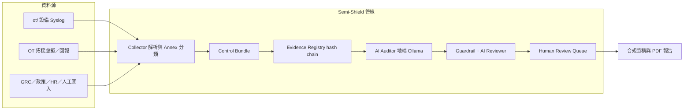
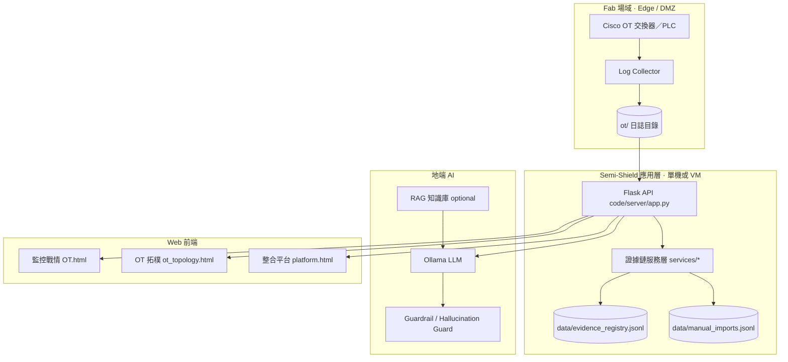
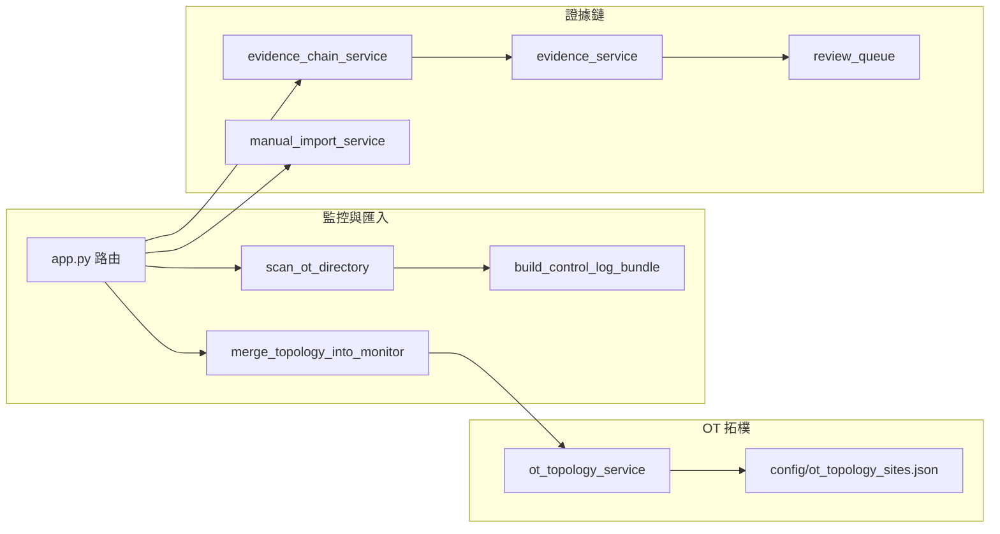
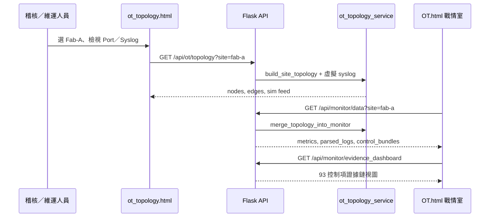

# 半導體 OT 場域之 AI 驅動證據鏈與傳統稽核路徑比較研究  
## ——以 Semi-Shield ISMS 實作為例

**作者：** Semi-Shield ISMS 專案團隊  
**版本：** 2026-03-19（論文版 · 含系統架構與介面附圖）  
**對應程式庫：** `ot_test`（Semi-Shield ISMS）

---

## 摘要

半導體封裝與製造場域的營運技術（Operational Technology, OT）環境，在 ISO/IEC 27001:2022 稽核中常面臨「證據分散、難以重播、合規結論與原始紀錄脫鉤」等問題。本文以實作平台 **Semi-Shield ISMS** 為案例，提出以 **AI 證據鏈（AI-driven evidence chain）** 為核心的合規方法，並與 **傳統稽核證據鏈** 做系統性對照。Semi-Shield 將 OT syslog、OT 拓樸虛擬／真實回報、控制項 KPI 與非遙測類稽核資料（政策、GRC、HR、實體紀錄、人工匯入批次）匯入同一管線，經 **Control Bundle → Evidence Registry（SHA-256 hash chain）→ 地端 LLM 診斷 → 護欄與 AI Reviewer → Human Review Queue** 後，方允許合規宣稱，並以 **「No Evidence, No Compliance Claim」** 為不可違反之設計原則。

實作上支援 Annex A **93 項**控制項視圖（含 `auto_syslog` 與 `auto_import` 兩類自動化分級），監控戰情室提供 Semi-Shield 與傳統路徑的並列流程比較，並整合 **OT Purdue 拓樸**、**人工資料匯入分頁** 與 **整合平台（監控＋AI 對話）**。研究結果顯示：AI 證據鏈在 **可追溯性、完整性校驗、控制項對映規模與 OT 即時性** 上優於傳統以 Excel／Email／PDF 為主的作法；傳統路徑在 **人工彈性與離線稽核習慣** 上仍具適用情境，但需承擔較高的營運與稽核成本。

**關鍵詞：** ISO 27001；OT 資安；證據鏈；合規自動化；大型語言模型；Syslog；hash chain；Purdue 模型

---

## 1 緒論

### 1.1 研究背景

半導體供應鏈的 ISMS 稽核，除 IT 一般控制外，OT 區域（Purdue 模型 Level 0–3.5）需證明存取控制、組態變更、日誌完整性、惡意程式防護等要求。實務上，證據常來自交換器 flash 匯出之 syslog、SCADA／MES 紀錄，以及政策文件與人員訓練紀錄。傳統作法依賴工程師 **CLI 匯出、截圖、試算表彙整與 Email 傳遞**，稽核員再以 **訪談與靜態 PDF** 形成結論。此模式在 **跨控制項關聯、事件重算、完整性證明** 方面存在結構性弱點。

近年地端部署之大型語言模型（LLM）與 RAG 技術，使「在場域內對原始紀錄做診斷摘要」成為可能；若缺乏 **證據 ID、雜湊鏈與審核閘門**，則 LLM 輸出易淪為不可稽核的自由文字。Semi-Shield ISMS 之設計目標，即為 **將 AI 嵌入可驗證之證據鏈**，而非取代證據本身。

### 1.2 研究問題

1. 傳統 OT 合規證據鏈在 ISO 27001 Annex A 對映上有哪些結構性限制？  
2. AI 證據鏈應包含哪些必要節點，才能同時滿足 **自動化效率** 與 **稽核可追溯**？  
3. 在相同控制項集合下，Semi-Shield 路徑與傳統路徑於 **資料來源、完整性、AI 診斷綁定、人工閘門、即時性** 等面向有何差異？

### 1.3 貢獻

- 提出 **雙軌自動化分級**：`auto_syslog`（OT 遙測／syslog 分類桶）與 `auto_import`（AI 全自動匯入＋**人工資料匯入**）。  
- 實作 **Evidence Registry** 與 **hash chain**，並將 LLM 診斷約束於 bundle 原文引用。  
- 於監控戰情室提供 **93 控制項** 之證據鏈流程視覺化，並內建 **Semi-Shield vs 傳統** 對照表。  
- 整合 **OT 拓樸（Fab-A／Fab-B）** 作為 syslog 匯入與場域可視化來源，支援 **Port 連線表** 與 **虛擬 syslog 串流**。

---

## 2 傳統稽核證據鏈及其限制

### 2.1 典型流程（Traditional Evidence Chain）

| 步驟 | 活動 | 特徵 |
|------|------|------|
| T1 | 人工 CLI／截圖 | 無集中 collector，設備與人員異質 |
| T2 | Excel／Word 清單 | 版本分散，欄位不一致 |
| T3 | Email 傳遞 | 附件散落，缺乏密碼學完整性 |
| T4 | 靜態 PDF 報告 | 稽核當下快照，難以對同一 KPI 重算 |
| T5 | 訪談式合規宣稱 | 缺乏行級 trace，通常無 `evidence_id` |

### 2.2 結構性問題

1. **弱關聯（weak linkage）**：合規結論與原始 syslog 行號、檔名、時間戳之間常無機器可讀連結。  
2. **不可重播（non-replayable）**：PDF 為靜態快照，OT 環境變更後無法以相同規則重算指標。  
3. **跨控制項拼貼成本高**：例如 A.5.15 與 A.8.19 需人工關聯多份匯出。  
4. **AI 使用失序**：若直接在 Chat 介面詢問「是否合規」，輸出無 evidence 綁定，不符合「可證明宣稱」之稽核邏輯。

---

## 3 Semi-Shield AI 證據鏈架構

### 3.1 設計原則

**No Evidence, No Compliance Claim：** 任何合規宣稱必須對應 Evidence Registry 中之 `evidence_id`，且 payload 經 SHA-256 雜湊並鏈結至前一筆紀錄（`prev_hash` → `payload_hash`）。

### 3.2 邏輯證據鏈管線



### 3.3 系統部署架構（地端邊緣）



**說明：** 本實作以 **地端部署** 為主，syslog 與 registry 不離廠；LLM 推論經 Ollama，可選微調模型（如 OT 領域 Gemma）。前端以靜態 HTML＋JavaScript 模組呼叫 REST API，整合平台以 iframe 嵌入戰情室、拓樸與 AI 對話。

### 3.4 軟體模組分解



| 模組 | 路徑 | 職責 |
|------|------|------|
| API 閘道 | `code/server/app.py` | 路由、OT 掃描快取、monitor／evidence_dashboard、人工匯入 API |
| 證據鏈視圖 | `code/services/evidence_chain_service.py` | 93 項 Annex A、Semi-Shield／傳統步驟、display log 解析 |
| 註冊表 | `code/services/evidence_service.py` | `evidence_id`、SHA-256、hash chain |
| 人工匯入 | `code/services/manual_import_service.py` | `manual_imports.jsonl`、示範批次模擬 |
| OT 拓樸 | `code/services/ot_topology_service.py` | Purdue 分層、Port 表、虛擬 syslog、戰情室 KPI 合併 |
| 前端戰情 | `web/OT.html`、`web/ot_evidence.js` | 全控制項格狀、證據鏈 SVG、人工匯入分頁 |
| 前端拓樸 | `web/ot_topology.html` | 場域地圖、場域控制台彈窗、Syslog 串流 |

### 3.5 雙軌自動化分級

| 分級 | 代碼 | 資料來源 | Semi-Shield 鏈前段差異 |
|------|------|----------|-------------------------|
| OT Syslog 自動化 | `auto_syslog` | `ot/`、拓樸 `topology://` 虛擬 syslog | 正規化 → Regex／信號分類 → KPI 計數 |
| AI 全自動／人工匯入 | `auto_import` | 政策、GRC、**戰情室人工表單**、模擬批次 | 結構化 → Annex A 對映 → 完整性檢查 |

兩軌在 **Control Bundle 之後合流**：皆經 Evidence Registry、LLM 診斷、護欄、Review Queue 後方可宣稱。

### 3.6 OT 拓樸與監控戰情室資料流



---

## 4 AI 證據鏈與傳統路徑之比較

### 4.1 六面向對照

| 面向 | Semi-Shield AI 證據鏈 | 傳統稽核證據鏈 |
|------|------------------------|----------------|
| 資料來源 | 集中 `ot/`＋拓樸匯入；非遙測經 AI／人工匯入 | 分散匯出／截圖；Email 附件 |
| 完整性 | `payload_hash` + `prev_hash`；append-only registry | 通常無密碼學校驗 |
| 控制項對映 | 93 項矩陣；syslog 自動 + 匯入對映 | 稽核員手動對照 Annex A |
| AI 診斷 | 綁定 `evidence_id` 與 Control Bundle | 自由文字或口頭結論 |
| 人工閘門 | Review Queue 為強制節點 | 依稽核員個人經驗 |
| OT 即時性 | 戰情室 KPI 可刷新 | 年度／季度批次 |

### 4.2 AI 作為「證據鏈中的一環」

- **輸入邊界**：僅允許已註冊 bundle、匯入片段與 ot/ 語料庫。  
- **輸出邊界**：Guardrail 過濾；AI Reviewer 標記需人工覆核之結論。  
- **失敗模式**：無 evidence 則拒絕自動「合規通過」宣稱（原則性約束）。

---

## 5 系統實作概要

### 5.1 技術堆疊

| 層級 | 技術 |
|------|------|
| 後端 | Python 3.12+、Flask（`code/server/app.py`） |
| 證據鏈 | `evidence_chain_service.py`、`evidence_service.py` |
| 人工匯入 | `manual_import_service.py` → `data/manual_imports.jsonl` |
| LLM | Ollama；可選微調 OT 模型 |
| 前端 | `OT.html`、`ot_evidence.js`、`ot_topology.html`、`platform.html` |
| 設定 | `config/ot_topology_sites.json`、`compliance/annex_a_controls.json` |

### 5.2 關鍵 API（節錄）

| 方法 | 路徑 | 說明 |
|------|------|------|
| GET | `/api/monitor/data?site=` | OT 掃描＋拓樸合併、KPI、bundles |
| GET | `/api/monitor/evidence_dashboard` | 93 控制項證據鏈與比較表 |
| GET | `/api/ot/topology?site=` | Purdue 拓樸、Port 連線 |
| POST | `/api/monitor/manual_import` | 提交人工稽核資料 |
| POST | `/api/monitor/manual_import/simulate` | 模擬示範批次 |
| POST | `/api/audit/analyze` | 單控制項地端 LLM 診斷 |
| GET | `/api/evidence` | Evidence Registry 列表 |

### 5.3 戰情室分頁結構

1. **監控戰情 · 全控制項**：Annex A 93 項格狀卡片、日誌表、歷史串流。  
2. **AI 匯入 · 人工資料**：控制項選擇、原文貼上、**模擬匯入**、最近紀錄。  
3. **證據鏈 vs 傳統稽核**：六面向對照與管線摘要。

---

## 6 系統介面與操作情境（附圖）

以下附圖來自專案 `docs/ppt_assets/`，展示 Semi-Shield ISMS 之主要操作畫面；論文排版時可置於「系統實作」或「案例展示」章節。

### 圖 1 整合平台與監控戰情並排（Platform Split View）

整合平台同時嵌入 **監控戰情** 與 **AI 對話**，右側為對話紀錄；左側呈現 ISO 27001 控制項 KPI、合規日誌表與歷史 syslog 串流，體現 **證據在前、AI 在後** 之交互模式。


### 圖 2 監控戰情室儀表板（Monitoring War Room）

六項 OT 主稽 KPI（如 A.8.24、A.8.19、A.5.15 等）、合規日誌追蹤表、不符合事件統計圖與全量歷史日誌區，為 **auto_syslog** 軌之主要操作面。


### 圖 3 控制項詳情與地端 LLM 診斷（Evidence Modal）

點選控制項後，彈窗顯示 **原始資安日誌內容**、指標摘要，並可執行 **地端診斷分析**；輸出為引用 bundle 原文之結構化報告，對應證據鏈中 **AI Auditor** 節點。


### 圖 4 分析模型選擇（On-Prem LLM Selector）

戰情室可選 **Ollama／微調模型** 作為稽核報告與診斷模型，符合 OT 場域 **資料不出廠** 需求。


### 圖 5 AI 對話與圖表生成（Agent + Charts）

Cyber Agent 在 RAG 啟用下，依 OT 控制項語料生成柱狀／圓餅圖，輔助解讀 KPI；對話仍應與 registry 證據並用，避免未綁定 evidence 之宣稱。


### 圖 6 整合平台圖表區（Platform Analytics）

平台層級之統計圖與導覽，支援 **並排檢視** 戰情與對話。


> **補充（2026-03 實作）：** OT 拓樸頁（`/topology`）提供 Purdue 分層、**場域控制台** 彈窗（廠區切換、Port 表、Syslog 串流）；戰情室 **證據鏈橫向流程 SVG** 與 **人工匯入分頁** 見 `web/OT.html`、`web/ot_evidence.js`。若需更新附圖，請於上述頁面擷圖後覆蓋 `docs/ppt_assets/` 或新增 `docs/paper_assets/`。

---

## 7 討論

### 7.1 AI 證據鏈之優勢

- **可稽核的 AI**：結論可回溯至 `evidence_id` 與原始 log／匯入行。  
- **規模化對映**：93 控制項一致資料模型。  
- **OT 與 GRC 匯流**：同一 Review Queue 與 registry。  
- **拓樸語意**：Fab 場域、Port 與 syslog 來源可對齊，降低「只有數字沒有場域」之溝通成本。

### 7.2 限制與風險

- 規則／分類器需隨韌體與協定演進維護。  
- LLM 幻覺仍需 Human Review Queue。  
- 人工匯入與 AI 解析仰賴文件品質。  
- 地端 Ollama、GPU 與 registry 備援需納入 OT 維運。

### 7.3 傳統路徑仍適用之情境

- 僅接受 PDF 交付之外部稽核見證。  
- 極端 air-gapped 且關閉 LLM 節點（可保留 syslog＋registry）。  
- 試點場域證據量極小。

---

## 8 結論

Semi-Shield ISMS 展示了一種 **以證據為中心、AI 為受控節點** 的 OT 合規架構。與傳統「匯出—試算表—Email—PDF—訪談」路徑相比，AI 證據鏈在 **完整性、可追溯性、控制項覆蓋與即時戰情** 上具明確優勢；其關鍵在於 **每一個合規宣稱均鏈結至可驗證之 evidence 物件**。後續工作包括：GRC API 對接、hash chain 與外部時間戳互操作、跨 Fab 證據聯邦比對，以及論文級實證量化（處理延遲、稽核人時、漏報率）。

---

## 參考文獻

1. ISO/IEC 27001:2022, *Information security, cybersecurity and privacy protection — Information security management systems — Requirements*.  
2. ISA-95 / Purdue Model, *Enterprise-Control System Integration*.  
3. NIST SP 800-82, *Guide to Industrial Control Systems (ICS) Security*.  
4. Semi-Shield ISMS 原始碼：`code/services/evidence_chain_service.py`、`code/services/evidence_service.py`、`code/services/manual_import_service.py`、`web/ot_evidence.js`.

---

## 附錄 A Evidence ID 格式

```
EV-{site}-{control_key}-{collected_at_utc}-{integrity_hash8}
```

Registry 每筆含 `prev_hash`、`payload_hash`、`annex_a_id`、`source_file`、`log_line_ref` 等欄位。

## 附錄 B 英文短摘要（Abstract）

*Semi-Shield ISMS is an on-premise ISO 27001 compliance platform for semiconductor OT environments. It implements a dual-tier automation model (syslog classification and AI-driven or manual audit-data import), merges OT topology feeds into the monitoring war room, registers control bundles in a hash-chained evidence registry, and constrains local LLM diagnostics to cited bundles under the principle “No Evidence, No Compliance Claim,” in contrast to traditional spreadsheet- and interview-driven audit chains.*

---

*文件結束 · 產生 Word 版：`py -3.12 scripts/build_evidence_chain_paper_docx.py`*
