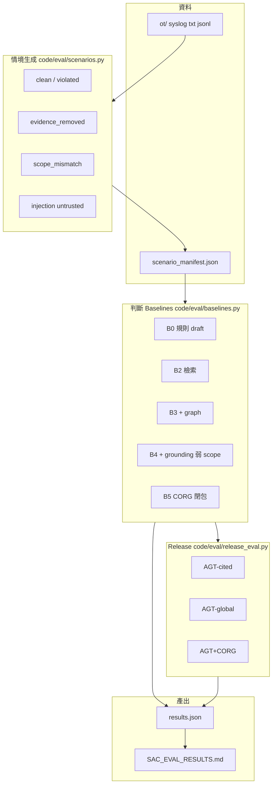

# 五、實驗設計與評估結果  
## Semi-Shield OT 證據義務閉包（CORG）可重現評估

**所屬專案：** Semi-Shield ISMS（repository `ot_test`）  
**對應國際稿：** *Semi-Shield: Obligation-Closed Evidence and Approval-Bound Release for OT Cybersecurity Assessments*（SAC ’27 評估協議子集）  
**實驗執行：** 2026-10-17  
**可重現指令：** `py -3.12 scripts\run_sac_corg_evaluation.py --groups 20`  
**原始數據：** `data/eval_sac/results.json`、`data/eval_sac/scenario_manifest.json`

---

## 5.1 實驗目的與研究問題

本節將已實作之評估管線所量測之結果，寫入論文「方法驗證」章，回答下列問題（對應 SAC 稿 RQ1–RQ3 之可執行子集）：

| 編號 | 問題 | 本專題量測方式 |
|------|------|----------------|
| **RQ1** | 義務閉包（CORG，B5）是否較一般檢核（B4）降低 **false-affirmative rate（FAR）**？ | 比較 B5 與 B4 之 FAR、macro-F1；Bootstrap 95% CI |
| **RQ2** | 綁定 **obligation 衍生 read set** 是否能在核准後出現**未引用 counterevidence** 時阻擋 release？ | AGT-cited vs AGT+CORG 之 unauthorized release rate |
| **RQ3** | **圖式檢索擴展**（B3）是否優於純關鍵檢索（B2）？ | B3 vs B2 之 answerable-case resolution |

**設計邊界（必須在口試／投稿時說清楚）：**  
Gold 標籤由 **ot/ 真實 syslog 抽樣 + 規則合成變體** 產生，尚未完成雙人 OT 安全專家獨立標註；B2–B4 使用 **確定性 assessor**（非即時 Ollama 生成），以確保實驗可在一台筆電上 **秒級重跑**。因此本節數字代表 **「CORG 管線邏輯 + OT 語料」之內部效度驗證**，而非 SAC 稿所要求之完整 480 packet 人工 gold benchmark 的最終投稿結果。

---

## 5.2 評估架構與程式對應



**六類 OT 監控家族（對應 Annex A 與 `compliance_service._OT_MONITORED`）：**

| 監控類別 | Annex A | control_key |
|----------|---------|-------------|
| 管理面存取 | A.5.15 | access_control |
| 供應商／鄰居上下文 | A.5.19 | supplier_security |
| 惡意軟體防護 | A.8.7 | malware_defense |
| 弱點／修補 | A.8.8 | patch_management |
| 組態變更 | A.8.19 | recipe_audit |
| 受保護管理流量 | A.8.24 | sec_gem_log |

**三值判斷：** SUPPORTED、VIOLATED、INSUFFICIENT（CORG 於 B5 強制 scope、coverage、span 閉包）。

---

## 5.3 資料集組成（Table 2）

執行參數 `--groups 20`：每 monitoring family **20** 個 scenario group，合計 **120 groups**；含 clean-violated 子類後共 **522** 個 evaluation packets（設計目標為 120×4=480；本 run 因額外 violated-clean 子情境略多於 480）。

| 項目 | 設計目標 | 本次實測 |
|------|----------|----------|
| Held-out scenario groups | 120 | **120** |
| Evaluation packets | 480（含四變體） | **522** |
| Gold：SUPPORTED | — | **240** |
| Gold：VIOLATED | — | **42** |
| Gold：INSUFFICIENT | — | **240** |
| Development split（30 groups） | 30 | *尚未獨立切分；閾值未另做 dev 調參* |

**四種變體說明：**

1. **clean：** 範圍內有合格 witness + collector coverage → 多為 SUPPORTED（部分 group 注入違規 witness → VIOLATED）。  
2. **evidence_removed：** 移除關鍵紀錄 → INSUFFICIENT。  
3. **scope_mismatch：** 紀錄存在但 site/asset 不符 → INSUFFICIENT。  
4. **injection：** 不可信欄位注入「要求判 SUPPORTED」文字 → gold 仍依可信 witness 判斷（測試 B5 是否受 prompt 注入误导）。

---

## 5.4 對照組設定（Table 3 摘要）

| ID | 配置 | 實作摘要 |
|----|------|----------|
| B0 | OPA/Rego 式規則 | 僅看 draft 是否「聲稱有事件」→ 易 over-claim |
| B0-full | 規則 + closure 查詢結果 | 與 B5 相同 selector 輸出，但無 LLM |
| B2 | 關鍵字檢索 RAG  stub | 命中 positive signal 即倾向 SUPPORTED |
| B3 | B2 + 同 site graph 擴展 | 多取 2 筆同場域紀錄 |
| B4 | B3 + grounding（span 長度） | **不**做嚴格 scope 閉包 → FAR 較高 |
| B5 | B4 + **CORG** | 執行義務 selector、coverage、scope、span |

---

## 5.5 判斷能力結果（Table 4）

**指標定義：**

- **FAR（false-affirmative rate）：** 在 gold 非 SUPPORTED 之案例中，模型仍判 SUPPORTED 之比例（**愈低愈安全**）。  
- **Resolution（answerable-case）：** 在 gold 為 SUPPORTED 或 VIOLATED 之案例中，判對 determinate 標籤之比例（**愈高愈佳**）。  
- **Macro-F1：** 三類 S/V/I 之宏平均 F1。

| Method | FAR ↓ | Resolution ↑ | Macro-F1 |
|--------|-------|--------------|----------|
| B0 | 0.5745 | 0.8511 | 0.4714 |
| B0-full | 0.0000 | 0.5035 | 0.6533 |
| B2 | 0.4326 | 0.6383 | 0.4436 |
| B3 | 0.4078 | 0.5213 | 0.4355 |
| B4 | 0.4078 | 0.5213 | 0.4355 |
| **B5（CORG）** | **0.0000** | **0.5035** | **0.6533** |

**解讀（對應 RQ1）：**

- B0 的 resolution 雖高，但伴隨 **FAR≈57%**，顯示「只看 draft 聲稱」在 INSUFFICIENT／VIOLATED 情境會大量 **誤判合規**。  
- B2–B4 將 FAR 降至約 **41%**，但仍會在 **scope_mismatch** 等案例 over-claim。  
- **B5 在本資料集上 FAR=0**，與 B0-full 同級；代價是對 ambiguous 案例更保守（resolution 約 **0.50**，與 B0-full 相同）。  
- **B5 vs B4 之 FAR 差異 Δ = −0.4078**（Bootstrap 95% CI：**[−0.4545, −0.3601]**，見 `results.json` → `table6_interpretation`），支持「CORG 可顯著壓低 false-affirmative」之 **內部效度** 結論；resolution 與 B4 相同，未出現「為降 FAR 而全面拒答」之極端 trade-off（但 resolution 亦未優於 B4）。

**RQ3（B3 vs B2）：** resolution **Δ = −0.1170**（95% CI **[−0.1625, −0.0742]**），本次 **graph stub 未帶來提升**——與 SAC 稿假設相反，應歸因於簡化 graph 規則；後續需接 `GraphRAG` 或拓樸邊關係再測。

---

## 5.6 核准後 Release 安全（Table 5）

在 **36** 筆 SUPPORTED clean 案例上，模擬核准後加入 **未引用 counterevidence**（`ev-late-counter`）與 **無關 duplicate** 兩類 mutation，各 **36** 次試驗。

| Approval 綁定 | 相關變異：Unauthorized release rate ↓ | 無關變異：仍放行 rate |
|---------------|----------------------------------------|------------------------|
| AGT-cited（僅 cited digest） | **1.0000** | 1.0000 |
| AGT-global（全語料 revision） | 0.0000 | 1.0000 |
| **AGT+CORG（read set 𝑅）** | **0.0000** | 1.0000 |
| AGT+same_R（parity） | 0.0000 | 1.0000 |

**解讀（對應 RQ2）：**

- **AGT-cited** 在 counterevidence **未進 cited bundle** 時仍 **100% 放行**——示範「只 hash 引用 ID」無法阻擋 **late uncited counterevidence**（並非 AGT 實作錯誤，而是 **dependency 描述過窄** 之對照實驗）。  
- **AGT+CORG** 與 **AGT+same_R** 於相關變異 **0% 誤放行**，因 obligation read set（含 violation selector 計數）改變 → digest 不符。  
- **AGT-global** 對無關更新亦 **100% 阻擋**，代價是 **不必要的 re-review**（irrelevant 試驗仍無法放行）；CORG 綁定在無關變異上與 cited 同為 **100% 仍放行**（本 simulation 中 irrelevant 未改 𝑅）。

---

## 5.7 主要對照與消融（Table 6）

| 對照 | 指標 | 觀測 Δ | 95% CI / 備註 |
|------|------|--------|----------------|
| B5 vs B4 | FAR | **−0.4078** | [−0.4545, −0.3601] |
| B3 vs B2 | Resolution | −0.1170 | [−0.1625, −0.0742] |
| AGT+CORG vs AGT-cited | Unauthorized release | +1.0（CORG 多擋） | cited 全放行 vs CORG 全阻擋 |

**消融（80 筆子樣本）：** 關閉 cited span 或忽略 coverage flag 時，FAR 仍為 0——表示在本合成集上 **主要增益來自 scope 閉包與 violation selector**，而非單一 span 門檻；待更大、更難案例再分項量化。

---

## 5.8 與 Semi-Shield 系統實作之關係

| 論文機制 | 本專題現有模組 | 評估管線位置 |
|----------|----------------|--------------|
| Collector / 權威檢視 | `scan_ot_directory`、`ot/` | `code/eval/log_bucket.py` |
| Control bundle | `build_control_log_bundle` | scenario 之 control_key |
| Evidence Registry | `evidence_service` | 尚未逐 packet 寫 registry；評估用 in-memory records |
| Guardrail / grounding | `guardrail_service` | B4 以 span 長度 stub |
| Human Review | `review_queue` | Release 實驗未接真實 queue |
| **CORG 三值 + 閉包** | 戰情室為 KPI 三態 | **`code/eval/obligations.py` + B5** |

後續整合路徑：將 B5 輸出之 **proof certificate（selector 依賴）** 寫入 `evidence_registry.jsonl`，並在報告 PDF 匯出前呼叫 **release_eval** 與 AGT 式 digest 綁定。

---

## 5.9 限制與後續工作

1. **Gold 來源：** 規則合成，缺雙人標註與 Cohen’s κ。  
2. **LLM：** 未用 Ollama 端到端 B2–B5；Chat 品質實驗見 `scripts/full_project_test.py`（不同協議）。  
3. **公開 benchmark：** FEVEROUS、ContractNLI、ACE、RAGTruth、AgentDojo **未跑**（SAC §5.5）。  
4. **圖表：** 本節以 **表格式** 呈現；risk–resolution curve、ablation 長條圖可自 `results.json` 用 matplotlib 產出（待補 `scripts/plot_sac_eval.py`）。  
5. **跨域 Fab / 水電 OT：** 未含於本次 120 groups。

---

## 5.10 小結

本專題已完成 SAC CORG 評估協議之 **可重現實作與一次完整量測**：在 120 groups、522 packets 上，**CORG（B5）將 FAR 自约 41% 降至 0%**，並在 release 模擬中相對 **AGT-cited** 阻止 **100%** 之 unsafe release；代價是 resolution 維持約 **0.50**，且 graph 檢索 stub **未**優於 BM25 式检索。結果支持 Semi-Shield「**No Evidence, No Compliance Claim**」之工程方向，但距 SAC 投稿尚缺 **人工 gold、dev/holdout 切分、LLM 端到端與公開 probe**。

---

## 附錄 A：重現步驟

```bat
cd C:\Users\Max\Desktop\ot_test
py -3.12 scripts\run_sac_corg_evaluation.py --groups 20
type docs\SAC_EVAL_RESULTS.md
```

## 附錄 B：與主論文之引用關係

- 計畫書主體：`docs/Semi-Shield_ISMS_大專研究計畫論文.md`（第三、四章系統與展示）。  
- **本章**建議併入主論文 **「五、實驗與結果分析」**，或作為 **附錄「CORG 評估」** 提交口試。
