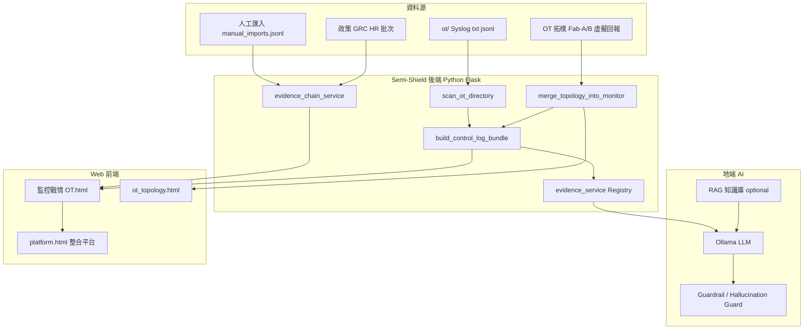
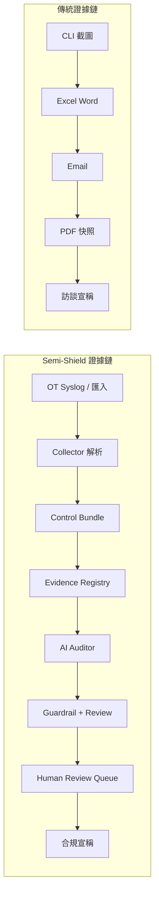
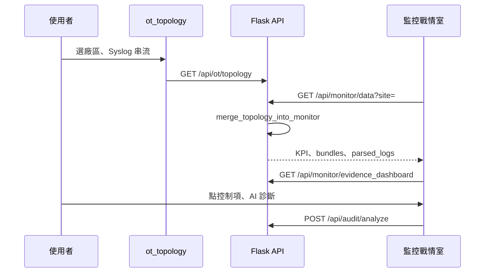

# Semi-Shield ISMS 研究計畫／論文  
## 半導體 OT 場域 AI 驅動證據鏈合規平台

**撰寫架構參考：** `大專生計畫.pdf`（摘要、動機、文獻、方法、預期成果、參考文獻）  
**實作專案：** 本 repository `ot_test`（Semi-Shield ISMS）  
**版本：** 2026-03-19

**摘要：** 半導體 OT 場域在 ISO/IEC 27001:2022 稽核中常面臨證據分散、難以重播、合規結論與 syslog／政策文件脫鉤等問題。本專題提出 Semi-Shield ISMS：以 AI 證據鏈為核心，整合 OT syslog、拓樸回報與 GRC／人工匯入，經 Evidence Registry（SHA-256 hash chain）、地端 LLM 診斷、Guardrail 與 Human Review Queue 後方允許合規宣稱，支援 Annex A 93 項雙軌視圖（syslog 自動化與 AI 匯入），並提供監控戰情室、OT 拓樸與整合平台。

**關鍵詞：** ISO 27001；OT 資安；證據鏈；合規自動化；大型語言模型；Syslog；hash chain；Purdue 拓樸；Agent 對話

---

## 一、緒論

### 1.1 研究背景

#### 1.1.1 半導體 OT 環境與資安治理需求

半導體產業為全球供應鏈與國家關鍵基礎設施之一。封裝、晶圓製造、測試與封測後段製程高度依賴營運技術（Operational Technology, OT）系統：從無塵室環境監控、機台通訊、到廠內 L2/L3 交換器、工業防火牆、OPC-UA／Historian、以及與 MES／ERP 的資料交換介面。隨 IT／OT 融合，攻擊面不再侷限於辦公室端點，而延伸至**產線停機風險、製程參數竄改、設備韌體與配方（recipe）機密**。國際標準 **ISO/IEC 27001:2022** 要求組織建立資訊安全管理系統（ISMS），並對 **Annex A** 所列控制措施提出可驗證之實施證據；稽核實務上常見「政策已訂、現場難證」的落差，尤其在 OT 維運節奏快、變更窗口短的 Fab，更須證明**日誌留存、存取控制、組態變更、弱點與惡意事件**等是否持續受控。

**NIST SP 800-82** 等 OT 安全文件強調：依 **Purdue 參考模型** 分層防禦、集中監控與事件分析、以及設定與修補管理。半導體客戶（晶圓廠、IDM、系統廠）在供應鏈資安問卷中日益要求封測／製造端說明 OT 監控與 ISMS 成熟度；主管機關對關鍵基礎設施資安法規的適用，亦使企業必須將**內部稽核**從「文件審查」推向「證據可重播、可對照控制項」的層次。因此，研究背景的第一層意義在於：**OT 不再是 ISMS 的附錄，而是需要獨立證據鏈的稽核對象**。

#### 1.1.2 傳統稽核證據路徑及其結構性限制

現場長期採用的 **傳統證據鏈** 大致為：工程師 CLI 登入設備 → 匯出 syslog 或 `show running-config` → 截圖或存成 flash 檔 → 以 **Excel／Word** 整理 Annex A 對照表 → **Email** 傳遞附件 → 稽核截止日前產出 **PDF 報告** → 必要時以 **訪談** 補強合規敘述。此路徑在人力充足、環境變動少時尚可運作，但存在多項結構性限制：

- **分散與版本漂移**：同一份「存取控制」證據可能同時存在於三位工程師的本機、不同日期的 zip 與不同版次的 Excel，難以判定何者為稽核有效版本。  
- **缺乏密碼學完整性**：Email 與 PDF 通常無 **payload hash** 或 **hash chain**，無法偵測事後篡改或混用他廠 log。  
- **行級追溯薄弱**：PDF 結論與原始 syslog **第幾行、哪個檔名、哪台設備** 之間常無穩定鍵值；稽核員難以 spot-check。  
- **KPI 不可重算**：OT 環境變更（新 switch、ACL 調整）後，年度 PDF 無法一鍵重算 pass／fail／review 比例。  
- **跨控制項關聯靠人工**：例如 A.5.15（存取）與 A.8.19（組態）本可共用部分 syslog，傳統流程卻常由不同同仁分別整理，產生矛盾敘述。

本專題將上述路徑抽象為戰情室 UI 中的「傳統證據鏈」五至九步流程，並與 **Semi-Shield 證據鏈** 並列對照，以凸顯研究背景中的 **「證據工程（Evidence Engineering）」** 需求，而非僅改寫報告文句。

#### 1.1.3 雲端 GRC 與 OT 地端部署之間的落差

市售 **GRC／合規自動化 SaaS**（持續控制監控、雲端身分整合、政策範本庫）在 **SaaS、SOC 2、一般 IT** 場景已相當成熟，但半導體 Fab 常見限制包括：**機台 log 不得離廠**、**air-gap 或弱連網區**、**設備協定與格式高度客製**，以及 **Annex A 與 OT 事件語意**（如 `CONFIG_I`、`CDP neighbor`、`sec_login`）並非雲端連接器預設範圍。本專題定位文件 `compliance/grc_positioning.json` 亦指出：相較 Vanta、Drata 等產品，Semi-Shield 差異在 **Local LLM、OT syslog→ISO 對映、evidence_id 全鏈路、Human Review Guardrails** 與 **Agent 多階段管線**。

因此研究背景包含一項明確判斷：**半導體 OT-ISMS 需要可地端部署、可離線演示、可接 Wazuh／OpenCTI 路線的整合平台**，而不是將 Fab syslog 上傳至公有雲再問 LLM「我們是否合規」。本研究以 Flask + 本機 `ot/` 語料 + Ollama 為主軸，呼應此部署現實。

#### 1.1.4 生成式 AI 興起與「無證據宣稱」風險

2023 年起 **大型語言模型（LLM）** 與 **RAG** 快速進入資安與法遵討論：政策摘要、控制項 gap 分析、稽核報告草稿等。若缺乏治理，LLM 可能 **幻覺** 出未發生的事件、未簽核的政策版本，或將訓練資料中的通用建議誤植為受稽組織現況。ISO 27001 精神要求 **「宣稱必須有 evidence 支持」**，故「只 Chat、不綁 evidence」的 AI 報告與標準要求本質上衝突。

學界與產業開始探索 **Agent Workflow**（Collector → Auditor → Reviewer → Reporter）、**Guardrail**（輸入注入攔截、輸出脫敏）、**Human-in-the-loop**（Review Queue），使 AI 成為 **管線節點** 而非 **證據來源本身**。本專題採 **append-only** 的 `evidence_registry.jsonl`、**SHA-256 hash chain**、以及 **`evidence_id` 串連 Control Bundle 與 LLM 診斷**，正是回應此背景：在 Fab 允許使用地端 AI 的前提下，**把 AI 鎖在證據之後**。

#### 1.1.5 本研究之定位：Semi-Shield ISMS

綜合上述，半導體 OT 場域同時承受 **法規與供應鏈稽核壓力**、**傳統證據路徑效率與完整性不足**、**雲端 GRC 難以覆蓋 OT 細節**，以及 **AI 必須受證據鏈約束** 等背景。**Semi-Shield ISMS** 以 **「No Evidence, No Compliance Claim」** 為設計原則，整合：

- OT **syslog Collector** 與六項 Phase 1 自動監控；  
- **93 項** Annex A 戰情室視圖（含 AI 匯入／人工匯入雙軌）；  
- **Evidence Registry** 與控制項 **Bundle**；  
- **地端 Ollama** 診斷、Guardrail、AI Reviewer、Human Review Queue；  
- **OT Purdue 拓樸** 與 **整合平台** 四窗格 UI。

本章 1.2～1.4 將在此背景上，進一步闡述研究動機、目的範圍與待解決之研究問題；第二章起則說明方法、系統實作與預期成果。

---

### 1.2 研究動機

研究背景描述「為何環境需要改變」；**研究動機**則說明「為何本團隊要投入 Semi-Shield 之設計與實作」。以下從利害關係人、技術缺口與可交付性三方面展開。

#### 1.2.1 利害關係人視角之動機

| 角色 | 現況困擾 | 本研究期望改善 |
|------|----------|----------------|
| OT 維運工程師 | 稽核前集中補 log、重複 CLI、被問「這段 log 對哪個 Annex A」 | 集中 `ot/` 掃描、拓樸對設備、戰情室一鍵看樣本與 KPI |
| 資安／CISO | 矩陣覆蓋率與 OT 脫鉤；AI 報告不敢直接採信 | 93 項視圖 + evidence_id；LLM 必須引用 bundle |
| 內部稽核員 | Excel 對照耗時；訪談比對 log 困難 | 控制項專屬證據鏈、原文區、PDF 檢查表、Review Queue |
| 外部稽核／客戶 | 難以驗證 PDF 與原始紀錄一致 | hash chain、registry 查詢、Semi vs 傳統對照表 |
| 研究／教學 | 缺可演示之 OT-ISMS 整合原型 | 開源式模組架構 + 論文可引用之管線 |

動機不僅來自「技術可行」，更來自 **多角色在同一證據模型上協作** 的需求：若只有後端腳本而無戰情室，稽核員仍會回到 Excel；若只有 UI 而無 registry，CISO 仍無法信任 AI 結論。

#### 1.2.2 技術與方法面之動機

**（1）證據難以「一次收集、多次重播、逐項對照」**

內部稽核要求對 **93 項** Annex A（本系統 `all_annex_controls_for_monitor()` 之完整視圖）逐項備證。傳統流程中，單是 **六項** OT 相關 syslog 指標，就可能消耗數人日；更遑論 A.5 政策面、A.6 人員面、A.7 實體面。動機在於建立 **可重入（re-entrant）管線**：`scan_ot_directory` 可重跑、metrics 可刷新、匯入批次可追加，且每次產出可選擇寫入 registry，使「同一控制項在不同時間點」具可比性。

**（2）雙軌控制項：Syslog 自動化與 AI 匯入缺一不可**

Phase 1 自動監控聚焦 **六項** `control_key`（`access_control`、`supplier_security`、`malware_defense`、`patch_management`、`recipe_audit`、`sec_gem_log`），對應 Annex A 如 **A.5.15、A.5.19、A.8.7、A.8.8、A.8.19、A.8.24**。其餘 **87 項**在矩陣中標為 `monitored: false`，需 **policy_doc、procedure、manual_review、training_record** 等類型 evidence。動機是拒絕「只做 SIEM 儀表板」或「只做 ChatGPT 稽核報告」的單極方案，而採 **`auto_syslog` + `auto_import`** 雙軌，並以 `control_evidence_profiles` 讓每項證據鏈敘述 **互不相同**，避免稽核簡報被質疑「套版」。

**（3）Fab 場域語意：拓樸、廠區、Port 與 log 來源對齊**

`ot_topology_service` 支援多 site（如 **fab-a／fab-b**）、L0～L3 節點、Port 表與模擬 syslog feed，並可 merge 至 monitor。動機在於回答稽核常見問題：「這段 **sec_login** 來自哪台 core switch？是否 DMZ 邊界？」僅列出 log 檔名不足以說明 **Purdue 層級** 與 **物理／邏輯拓樸**；拓樸模組使證據敘事具 **空間與連線上下文**。

**（4）地端 AI：機會、風險與治理邊界**

Fab 限制公有雲 LLM，但 **Ollama** 與本機微調模型使「地端診斷」成為可能。動機包括：（a）以 **RAG** 提供 ISO／OT 知識 grounding（可關閉）；（b）以 **Guardrail** 降低注入與惡意請求；（c）以 **AI Reviewer** 在 PoC 環境自動消化部分 Review Queue；（d）以 **Human Review Queue** 保留 fail／review 之強制人工閘門。LLM 被刻意放在 **Registry 之後**，並在 UI 明示 **傳統路徑** 對照，避免組織誤以為「裝了 AI 就自動通過 ISO」。

**（5）Agent 工作流與可維運模組**

`agent_orchestrator` 定義 Collector → Auditor → Reviewer → Reporter，對應 `/api/compliance/pipeline` 與戰情室按鈕。動機是將 **「誰在什麼階段做什麼」** 文件化，使大專／論文可討論 **Agentic compliance** 而不止於單次 prompt。模組化 `code/services/*` 亦方便分工開發：evidence、compliance、拓樸、人工匯入、review 各自演進。

**（6）可演示、可驗收之研究載體**

有別於純文獻比較，本 repository 含完整 **Web 前端**（戰情室、拓樸、合規、Agent）、**data/*.jsonl** 持久化、**run_ollama.bat／run_edge.bat** 啟動腳本。動機在於計畫／論文需 **可重現演示**（demo）：評審或口試時可現場模擬匯入 87 項人工 evidence、點選控制項看證據鏈、查 registry。此亦為後續 Phase 2（Wazuh 規則擴充、OpenCTI）預留 **接口與資料模型**。

#### 1.2.3 研究與實務貢獻動機（簡述）

- **實務**：提供半導體 OT 場域可參考之 **地端 ISMS 證據鏈原型**，降低內部稽核整理成本之前提下，不犧牲 traceability。  
- **方法**：提出並實作 **雙軌 Annex A 模型** + **per-control 證據鏈描述** + **Semi vs Traditional 對照**。  
- **教學**：可作為 OT 資安、ISMS、LLM governance 交叉課程之 **整合專題範本**。

---

### 1.3 研究目的與範圍

#### 1.3.1 研究目的

**總目的：** 設計並實作 **Semi-Shield ISMS**——一套面向半導體 OT、以 **證據鏈** 為核心、支援 **ISO/IEC 27001:2022 Annex A** 對照與 **地端 AI 輔助診斷** 之合規平台，並以實際原型驗證 **「No Evidence, No Compliance Claim」** 在內部稽核情境下之可操作性。

**具體目的（分項說明）：**

1. **建立統一證據資料模型**  
   - 匯流 **OT syslog**（`ot/`）、**拓樸事件**（merge topology into monitor）、**人工／GRC 匯入**（`manual_imports.jsonl`）至 **Control Bundle**（事件樣本、`metric_summary`、log 原文摘要）。  
   - 以 **`evidence_service.register_evidence`** 寫入 **`evidence_registry.jsonl`**，含 **SHA-256 payload hash**、**prev_hash** 鏈結與 **`evidence_id`** 查詢 API。  
   - 使戰情室、合規頁、Agent 對話均可引用 **同一 evidence 物件**，而非散落字串。

2. **實現 Annex A 雙軌自動化策略**  
   - **auto_syslog**：六項 `control_key` 之 regex／分類、pass/fail/review 計數、Wazuh 信號欄位對應。  
   - **auto_import**：其餘控制項之 AI 匯入管線敘述、人工 API、`simulate_demo_batch` 全矩陣示範匯入（skip／force 策略）。  
   - **`evidence_dashboard`** API 輸出 93 項 `controls[]`，含 `automation_tier`、`sources[]`、`semi_shield_chain`、`traditional_chain`、`log` 原文。

3. **建構可視化與操作介面**  
   - **監控戰情室**（`OT.html`）：控制項 grid、詳情 modal（加寬證據鏈 SVG）、AI 診斷、內部稽核 PDF、**AI 匯入·人工資料** 分頁。  
   - **OT 拓樸**（`ot_topology.html`）：viewBox 放大、場域控制台 modal、orthogonal 連線。  
   - **合規架構**（`compliance.html`）：覆蓋率、GRC 比較、識字卡、evidence 追溯圖。  
   - **整合平台**（`platform.html`）：四 iframe 同屏；**Agent 對話**（`agent_chat.html`）可注入匯入語料。

4. **約束地端 LLM 之合規用途**  
   - **Ollama／Edge CPU** 雙模式；環境變數控制 RAG、Guardrail、warmup。  
   - **`/api/audit/analyze`**、**`/api/agent/chat`** 要求 grounded 引用；Guardrail 對 OT／ISO 意圖 allowlist。  
   - **Review Queue** + **AI Reviewer**（`/api/review/auto`）處理 pending；狀態與 KPI 連動。

5. **評估、文件化與可重現性**  
   - KPI 對照 `compliance/kpi_targets.json`（矩陣覆蓋率、traceability、human review adoption 等）。  
   - 產出 **論文／計畫書**、模組說明、架構圖（Mermaid）、螢幕截圖；腳本 `build_isms_plan_paper_docx.py` 轉 Word。  
   - 提供 **Windows／Linux** 啟動腳本與 `app.py` 統一入口，使評審可重現 demo。

#### 1.3.2 研究範圍

**（1）領域、標準與假設**

- **標準主軸**：ISO/IEC 27001:2022 **Annex A**（2022 版 93 項控制項語意；本矩陣 Phase 1 以 A.5 全定義 + A.8 子集 + A.6／A.7 標題擴充為 **93 項視圖**）。  
- **場域主軸**：半導體／高科技製造 **Fab OT**；Purdue L0～L3；**Cisco 風格 syslog** 為主要測試語料（可含模擬事件）。  
- **參考框架**：NIST SP 800-82（OT 監控）、ISA-95／Purdue（拓樸語意）；**不**宣稱完整取代 ISO 27001 顧問或驗證機構流程。  
- **基本假設**：組織已願意將 syslog 匯出至受控目錄或 SIEM；內部稽核接受 **地端系統** 作為 evidence 索引（非雲端 GRC 唯一來源）。

**（2）系統功能範圍（In Scope）——依模組列舉**

| 模組 | 路徑／介面 | 納入功能 |
|------|------------|----------|
| 路徑與啟動 | `code/paths.py`, `app.py`, `run_*.bat/sh` | 專案根解析、Flask 啟動、Edge／Ollama 模式 |
| API 閘道 | `code/server/app.py` | monitor、topology、compliance、evidence、review、audit、agent、llm |
| 合規矩陣 | `compliance_service`, `annex_a_controls.json` | 覆蓋率、缺口識字卡、GRC 定位、KPI |
| Evidence | `evidence_service`, `data/evidence_registry.jsonl` | 註冊、hash chain、查詢 |
| 證據鏈 UI 資料 | `evidence_chain_service`, `control_evidence_profiles` | 93 項 dashboard、log 解析、Semi／Trad 鏈 |
| 人工匯入 | `manual_import_service`, `manual_imports.jsonl` | CRUD、全矩陣 simulate |
| OT 拓樸 | `ot_topology_service`, `ot_topology_sites.json` | 多 site、layout、sim_feed、merge monitor |
| 覆核 | `review_queue`, `ai_reviewer_service` | 佇列、resolve、auto review |
| AI 安全 | `guardrail_service`, `rag_service`, `hallucination_guard_service` | 輸入輸出、檢索、幻覺 guard（訓練資產在 train_ai/） |
| LLM | `ollama_service`, `agent_orchestrator` | 模型切換、pipeline、chat |
| 前端 | `web/*.html`, `ot_evidence.js` | 戰情室、拓樸、平台、合規、Agent |
| 語料 | `ot/` | syslog 樣本、擴充腳本 |
| 訓練（延伸） | `train_ai/` | LLM／RAG／Guard 微調；非執行期必要 |

**（3）排除範圍（Out of Scope）**

- 保證通過 **第三方 ISO 27001 認證** 或任何 **法律責任** 認定。  
- **PLC／S7／Modbus 即時工控協定**深度取證與工控入侵即時阻斷（本研究聚焦 **證據收集與 ISMS 對照**）。  
- Phase 1 **不**要求 93 項皆 syslog 自動化（僅 **6 項** monitored；其餘靠 import＋人工）。  
- **多租戶 SaaS、行動 App、完整 OpenCTI 部署**（僅列 Phase 2 路線）。  
- **正式 Wazuh 叢集維運**（可接事件格式，但 PoC 以目錄掃描與 regex 為主）。  
- 取代 **稽核員專業判斷**；AI Reviewer 為輔助，fail／review 仍須 Human Queue 核准。

**（4）研究對象、部署與資料邊界**

- **對象**：具 OT 網路與 ISMS 需求之封測／製造場域；實驗以 **Fab-A／Fab-B** 設定檔模擬多廠。  
- **部署**：地端單機或內網 VM；預設 **http://127.0.0.1:2000**；敏感 log **不出廠**。  
- **資料**：示範含 **simulated** syslog／匯入（標記 SIM）；真實 Fab 導入時需另行資料處理與授權。

**（5）階段劃分**

| 階段 | 內容 | 本研究交付 |
|------|------|------------|
| Phase 1 | 證據鏈、6 項 syslog、93 項 UI、拓樸、人工匯入、地端 LLM、Review | **主要完成** |
| Phase 2 | Wazuh 15+ 規則、GRC API、OpenCTI 回饋、門禁整合 | 論文 **未來工作** |

#### 1.3.3 預期達成之研究指標

- **系統指標**：可一鍵啟動之原型；monitor API 回傳 metrics + bundles；evidence API 可列舉 registry。  
- **覆蓋指標**：93 項控制項皆可開啟詳情；六項 syslog 具非零或明確 review 狀態演示；87 項可透過 simulate 具 `manual_import_count ≥ 1`。  
- **追溯指標**：每條 registry 含 hash；戰情室顯示 `evidence_id`；LLM 診斷 UI 提示引用 bundle。  
- **治理指標**：Review Queue 可 enqueue／resolve；Guardrail 可演示 block／allow；Semi vs Traditional 對照表可匯出論述。  
- **文件指標**：完整緒論、方法、附圖；可選 docx；模組化功能說明供口試簡報。

#### 1.3.4 研究限制（誠實邊界）

- 語料以 **檔案型 syslog** 為主，非即時 streaming SIEM 全規模。  
- LLM 輸出品質受 **模型大小、CPU/GPU** 限制；Edge 模式可能關 RAG／Guardrail。  
- **A.6／A.7** 在矩陣中多為標題級定義，evidence 以匯入示範為主，非真實 HR／門禁系統連線。  
- 模擬資料用於 **教學與 PoC**，正式稽核須替換為真實簽核文件與正式 log 留存策略。

---

### 1.4 研究問題

在明確背景、動機與目的後，本研究欲回答下列 **研究問題（Research Questions）**：

**RQ1（資料模型）**  
如何設計 **單一證據資料模型**，使 OT syslog、拓樸事件、人工匯入與 Control Bundle 均能映射至 **ISO/IEC 27001:2022 Annex A** 之 93 項視圖，並區分 **auto_syslog** 與 **auto_import** 兩類自動化層級，而不遺失各控制項所需之 evidence type（如 `policy_doc`、`syslog_login`）？

**RQ2（完整性與追溯）**  
**Evidence Registry** 之 **hash chain** 與 **`evidence_id`** 應如何命名與鏈結，才能支援「由宣稱反查 payload」與「由 log 行反查 control_key」，並滿足內部稽核對 **完整性** 與 **不可否認性（在 PoC 層級）** 之演示需求？

**RQ3（AI 治理）**  
地端 **LLM** 在 **RAG、Guardrail、AI Reviewer、Human Review Queue** 組合下，如何將 **幻覺風險** 與 **無 evidence 宣稱** 降至可接受範圍，且仍保留稽核員對 **review／fail** 狀態之最終裁量？

**RQ4（對照與溝通）**  
**Semi-Shield 證據鏈** 與 **傳統證據鏈** 在 **資料來源、完整性、控制項對映、AI 診斷綁定、人工閘門、OT 即時性** 等面向，應如何 **結構化對照**，使管理者與稽核員能一眼理解導入本平台之 **質性與量化** 差異？

**RQ5（場域可解釋性）**  
**OT 拓樸**（多 site、Purdue 分層、Port 表）與 **monitor KPI** 之 **merge** 機制，能否提升 **「log → 設備 → 控制項」** 三層關係之可解釋性，並於戰情室 **原文 log 區** 一致呈現（含模擬與真實語料混合時之樣式統一）？

**RQ6（可重現與擴充）**  
模組化 **services** 與 **Agent pipeline** 是否足以作為 **Phase 2**（Wazuh 擴規、GRC 連接器、OpenCTI）之 **穩定接口**，並在大專／論文週期內完成 **可演示、可撰寫、可口試** 之閉環？

上述問題將於 **參、研究方法** 與 **肆、預期成果** 以 **系統設計、API、畫面與實驗演示** 作答；量化 KPI 則對照 `kpi_targets.json` 與戰情室即時數據說明達成度與限制。

---

## 二、文獻探討

半導體 OT 合規與 AI 稽助相關文獻與標準，可從 ISMS、OT 安全、分層模型、LLM 治理與證據完整性五個面向整理如下；並說明本專題與「僅以生成式 AI 產出稽核報告」路線之差異。

| 領域 | 代表文獻／標準 | 與本專題關聯 |
|------|----------------|--------------|
| ISMS | ISO/IEC 27001:2022 | Annex A 控制項矩陣、合規宣稱與證據要求 |
| OT 安全 | NIST SP 800-82 | ICS 監控、日誌留存與 Purdue 分層參考 |
| 分層模型 | ISA-95 / Purdue | OT 拓樸視覺化與 Fab 場域語意 |
| LLM 稽核 | RAG、地端 Ollama 實務 | 診斷需綁定語料與 guardrail，避免幻覺宣稱 |
| 完整性 | Hash chain、append-only log | 對應 `evidence_registry.jsonl` 設計 |

相較於「僅 Chat 詢問是否合規」，本專題強調 **AI 為證據鏈中受控節點**，與傳統 Excel／Email 路徑形成對照（見戰情室「證據鏈 vs 傳統稽核」分頁）。雲端 GRC 產品多聚焦 IT 連接器與政策範本，對 **OT syslog 行級事件** 與 **地端 LLM** 著墨有限；NIST 800-82 與 Purdue 模型則提供 **監控分層** 與 **日誌留存** 之設計依據，但並未規範 **evidence_id 與 hash chain** 之實作格式——此缺口為 Semi-Shield 文獻定位上之切入點。

---

## 三、研究方法

本章說明 Semi-Shield ISMS 之 **系統架構、證據鏈管線、核心模組、實施步驟** 與 **OT 拓樸—監控資料流**，對應本專題原始碼之可重現實作。

### 3.1 系統總體架構



### 3.2 證據鏈邏輯管線（Semi-Shield vs 傳統）



### 3.3 核心模組（對應程式）

| 模組 | 路徑 | 功能 |
|------|------|------|
| API 與 OT 掃描 | `code/server/app.py` | 路由、快取、`/api/monitor/data` |
| 證據鏈視圖 | `code/services/evidence_chain_service.py` | 93 項、流程 SVG 資料 |
| 註冊表 | `code/services/evidence_service.py` | `evidence_id`、SHA-256 鏈 |
| 人工匯入 | `code/services/manual_import_service.py` | 戰情室表單、模擬批次 |
| OT 拓樸 | `code/services/ot_topology_service.py` | Purdue、Port、排版、syslog 合併 |
| 戰情 UI | `web/OT.html`、`web/ot_evidence.js` | 全控制項格狀、彈窗證據鏈 |
| 拓樸 UI | `web/ot_topology.html` | 場域控制台、Syslog 串流 |
| 整合平台 | `web/platform.html` | 監控 + OT 拓樸 + AI 對話 |

### 3.4 研究步驟（工作項目）

**步驟一：** 建置 `ot/` 日誌解析（txt／jsonl）與六項 OT KPI 分類桶。本階段以地端目錄 `ot/` 為 Collector 輸入，將 Cisco 等設備匯出之 syslog 正規化為結構化事件，並依 regex／控制項對映規則分入六個 Phase 1 監控桶（如存取控制、供應商維運、惡意軟體、弱點、組態變更、密碼學使用），產出 pass／fail／review 計數與可供戰情室引用之事件樣本，作為後續 Evidence 註冊與 AI 診斷的技術證據基礎。

**步驟二：** 實作 Evidence Registry 與 review queue 連動。掃描與分類完成後，將各 `control_key` 之 payload 寫入 append-only 的 `evidence_registry.jsonl`，以 SHA-256 形成 hash chain 並核發 `evidence_id`；當 metric 狀態為 review 或 fail、或護欄／AI 判定需覆核時，自動或半自動 enqueue 至 `review_queue.jsonl`，使「有證據才宣稱、有異常必入列」可在資料面閉環。

**步驟三：** 擴充 Annex A 93 項證據鏈 dashboard API。在 `/api/monitor/evidence_dashboard` 匯總矩陣內全部控制項視圖，區分 `auto_syslog` 與 `auto_import` 雙軌，並為每項提供專屬證據來源、Semi-Shield／傳統證據鏈步驟、原文 log 區與人工匯入計數，供戰情室前端一次載入 93 張控制項卡片與詳情 modal，避免僅展示六項 OT KPI 而無法對外說明完整 Annex A 覆蓋。

**步驟四：** 整合 OT 拓樸 Fab-A／B 與虛擬 syslog 匯入戰情室。透過 `ot_topology_service` 與 `config/ot_topology_sites.json` 描述多廠區 Purdue 分層、Port 連線與設備節點，並將拓樸模擬或回報之 syslog 事件 merge 進 monitor 的 `parsed_logs` 與 KPI 計算，使戰情室除真實 `ot/` 檔案外，亦能在 Fab-A／B 語意下演示「設備—連線—日誌—控制項」之對應關係。

**步驟五：** 實作人工資料匯入分頁與模擬批次。針對無法自 syslog 自動推論之控制項，於戰情室提供「AI 匯入·人工資料」表單與 `manual_imports.jsonl` 持久化 API，並實作 `simulate_demo_batch` 為 87 項需人工證據之控制項各產生示範匯入，使證據鏈原文區可顯示 `[SIM]`／`[MANUAL]` 紀錄，補齊 GRC／政策／HR 等文件型 evidence 的演示路徑。

**步驟六：** 地端 LLM 單控制項診斷（`/api/audit/analyze`）與 guardrail。在已產生 Control Bundle 與（可選）RAG 上下文之前提下，以 Ollama 對單一控制項執行 grounded 診斷，輸入／輸出經 `guardrail_service` 過濾惡意或越權 prompt，並要求引用 bundle 或匯入原文，避免無 evidence 的合規結論直接寫入報告或宣稱。

**步驟七：** 整合平台並排檢視與稽核報告 PDF 匯出。完成 `platform.html` 四窗格（戰情室、OT 拓樸、Agent 對話、合規架構）之 iframe 配置與縮放，並於 `OT.html` 提供內部稽核檢查表 PDF 範本匯出，讓稽核演示可在同一畫面呈現 KPI、證據鏈、拓樸與 AI 對話，並產出可列印之檢核文件。

**步驟八：** 撰寫論文、架構圖與操作截圖。將上述實作整理為研究計畫／論文章節（含緒論、文獻、方法、成果），以 Mermaid 描述系統與證據鏈管線並匯出插圖，並擷取監控戰情室、AI 診斷、整合平台與 OT 拓樸等畫面作為附圖，形成可口試展示、可重現 demo 之完整交付。

### 3.5 OT 拓樸與監控資料流



---

## 四、預期成果與系統展示

### 4.1 系統介面與成果展示（附圖）

> 截圖存放：`docs/ppt_assets/`。論文排版時請保留圖號與圖說。

#### 圖 1 整合平台：監控戰情與 AI 對話並排

並排檢視體現「證據在前、AI 在後」：左側為 syslog KPI 與合規日誌，右側為 Cyber Agent（RAG + 圖表）。


#### 圖 2 監控戰情室儀表板

六項 OT 主稽 KPI、合規日誌表、不符合事件統計與歷史 syslog 串流。


#### 圖 3 控制項詳情與地端 LLM 診斷

原始 syslog／匯入原文、Semi-Shield／傳統證據鏈流程、地端診斷報告。


#### 圖 4 分析模型選擇（地端 Ollama）


#### 圖 5 AI 對話圖表分析


#### 圖 6 整合平台圖表區


#### 圖 7～9（建議自行擷圖補齊）

| 圖號 | 建議畫面 | 路徑 |
|------|----------|------|
| 圖 7 | OT Purdue 拓樸全圖 | `/topology` |
| 圖 8 | 場域控制台（Port／Syslog） | 拓樸右上角按鈕 |
| 圖 9 | AI 匯入·人工資料分頁 | 戰情室第二分頁 |

### 4.2 預期成果

1. 完成功能性 **Semi-Shield ISMS** 原型：監控戰情、93 控制項證據鏈、OT 拓樸匯入、人工匯入、地端 LLM 診斷。  
2. 完備 **Evidence Registry** 與 hash chain 機制，支援 `evidence_id` 追溯。  
3. 完備 **雙軌自動化分級**（syslog／AI 匯入）與傳統路徑對照表。  
4. 產出 **系統架構圖**（本文 mermaid）與 **操作截圖**（`ppt_assets` + 拓樸／人工匯入）。  
5. 完稿論文／研究計畫報告（Markdown + Word）。  
6. （延伸）與真實 GRC API、Wazuh 信號對接之實證評估。

### 4.3 預期結果（量化方向）

- 單次 OT 目錄掃描可處理 **數萬筆** syslog 事件計數，戰情室顯示 cap 樣本與全量 KPI。  
- **93 控制項** 均可開啟證據鏈流程視圖；`auto_syslog` 控制項可綁定 ot／拓樸原文。  
- LLM 診斷輸入邊界限於 bundle／匯入原文，並經 guardrail 過濾。

---

## 五、參考文獻

1. ISO/IEC 27001:2022, *Information security management systems — Requirements*.  
2. NIST SP 800-82, *Guide to Industrial Control Systems (ICS) Security*.  
3. ISA-95 / Purdue Enterprise Reference Architecture.  
4. Semi-Shield ISMS 原始碼：`code/services/evidence_chain_service.py`、`evidence_service.py`、`manual_import_service.py`、`ot_topology_service.py`。  
5. 專題內論文草稿：`docs/Semi-Shield_AI_Evidence_Chain_論文版.md`。

---

### 附錄 A：Evidence ID 格式

```
EV-{site}-{control_key}-{collected_at_utc}-{integrity_hash8}
```

### 附錄 B：主要 API（節錄）

| API | 說明 |
|-----|------|
| `GET /api/monitor/data?site=` | OT + 拓樸合併監控資料 |
| `GET /api/monitor/evidence_dashboard` | 93 控制項證據鏈 |
| `POST /api/monitor/manual_import` | 人工匯入 |
| `POST /api/monitor/manual_import/simulate` | 模擬批次 |
| `GET /api/ot/topology?site=` | OT 拓樸 JSON |
| `POST /api/audit/analyze` | 地端 LLM 診斷 |

---

*產生 Word：`py -3.12 scripts/build_isms_plan_paper_docx.py`*
